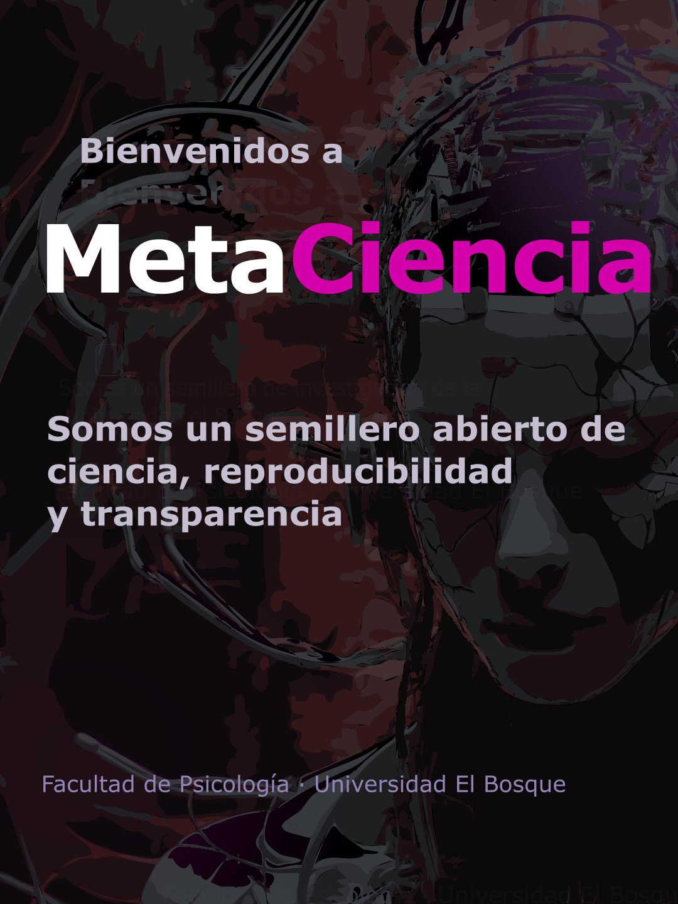
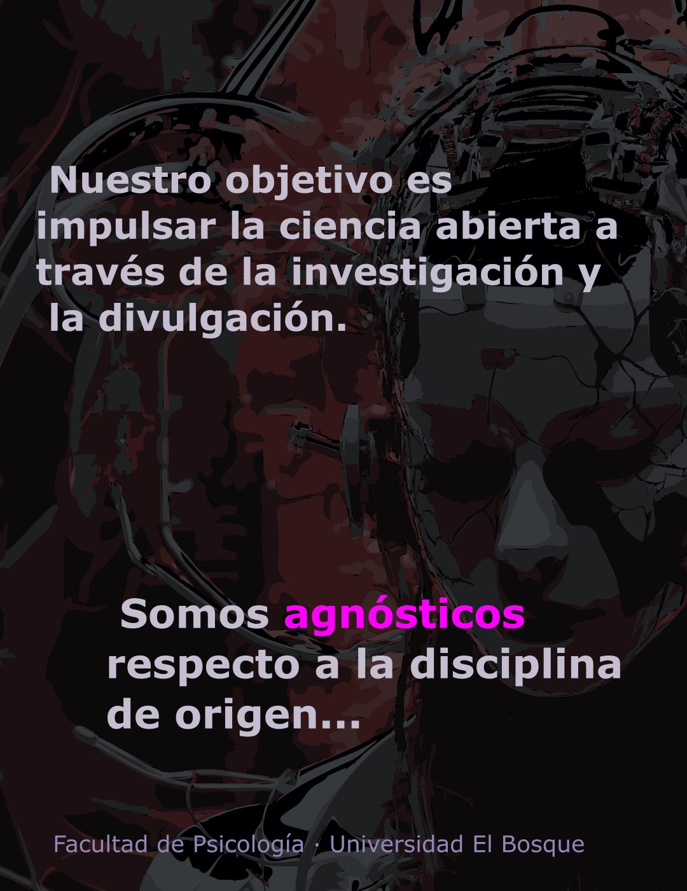
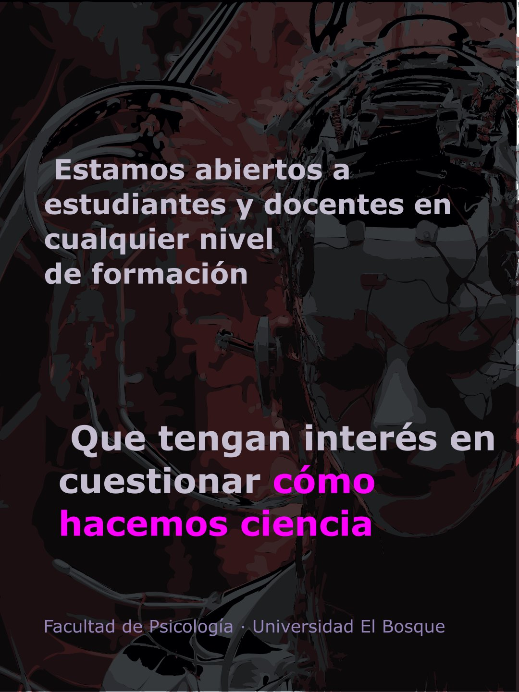

Nuestra primera publicación de divulgación es una serie de tres imágenes estáticas diseñada por [Marcela Puentes](../../../people/marcela-puentes.qmd). Presenta a <strong>MetaCiencia</strong> como un semillero abierto dedicado a la ciencia, la reproducibilidad y la transparencia, y hace una invitación a quienes quieran cuestionar cómo hacemos ciencia.

::: {layout-ncol=3}
{group="serie" alt="Bienvenidos a MetaCiencia. Somos un semillero abierto de ciencia, reproducibilidad y transparencia. Facultad de Psicología, Universidad El Bosque."}

{group="serie" alt="Nuestro objetivo es impulsar la ciencia abierta a través de la investigación y la divulgación. Somos agnósticos respecto a la disciplina de origen."}

{group="serie" alt="Estamos abiertos a estudiantes y docentes en cualquier nivel de formación que tengan interés en cuestionar cómo hacemos ciencia."}
:::

Somos un semillero abierto de la Universidad El Bosque. Recibimos estudiantes y docentes de cualquier programa y nivel (pregrado, posgrado, graduados). Si quieres participar, escríbenos a [jleongomez@unbosque.edu.co](mailto:jleongomez@unbosque.edu.co).

## Publicación original

-  [Ver en Instagram](https://www.instagram.com/p/Dd1evVplmBc/)
-  [Ver en YouTube](https://www.youtube.com/post/UgkxyM4q8jAWWS_12WdZrHIxHBWYd5lB8hHq)
