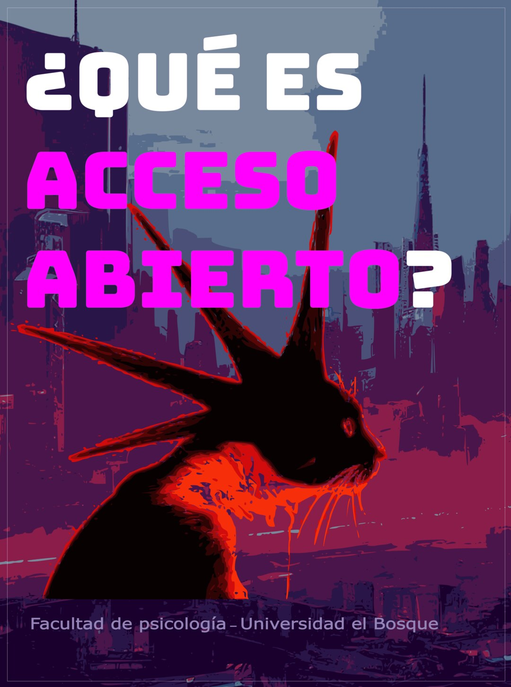
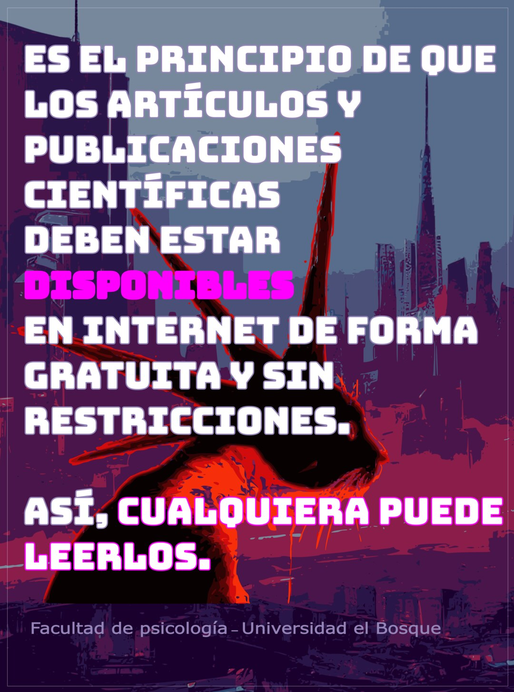
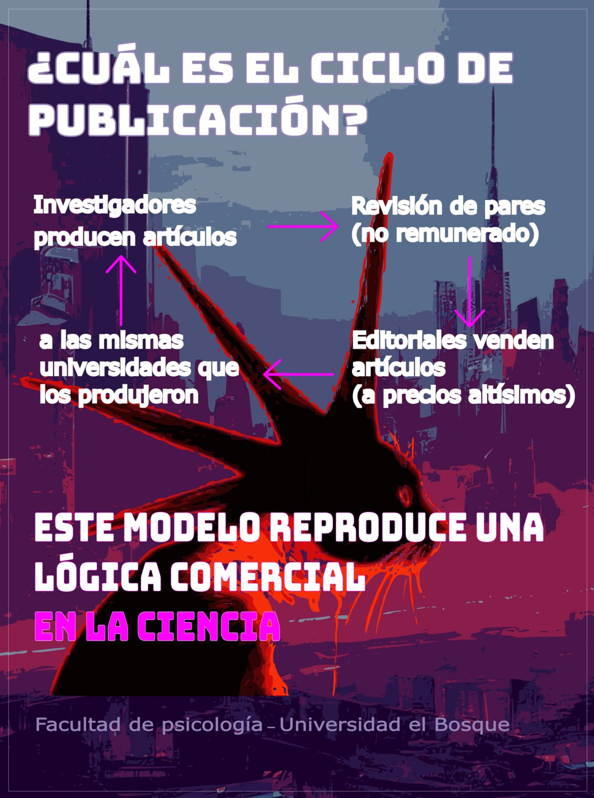
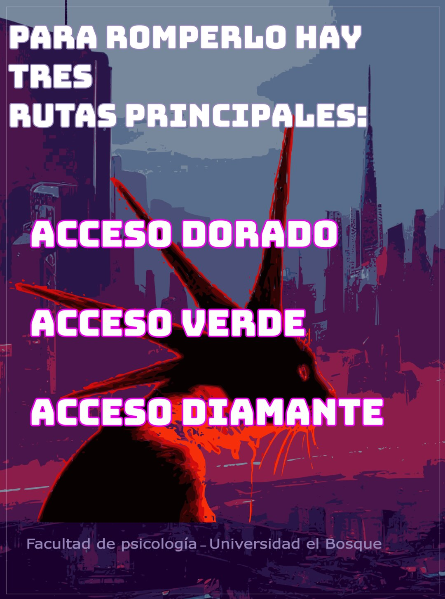
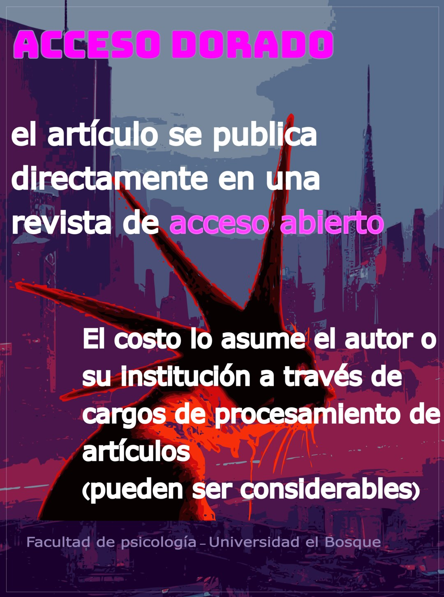
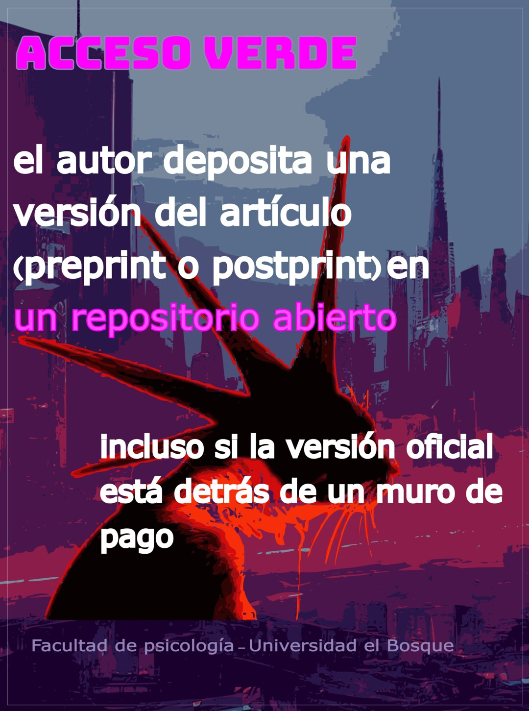
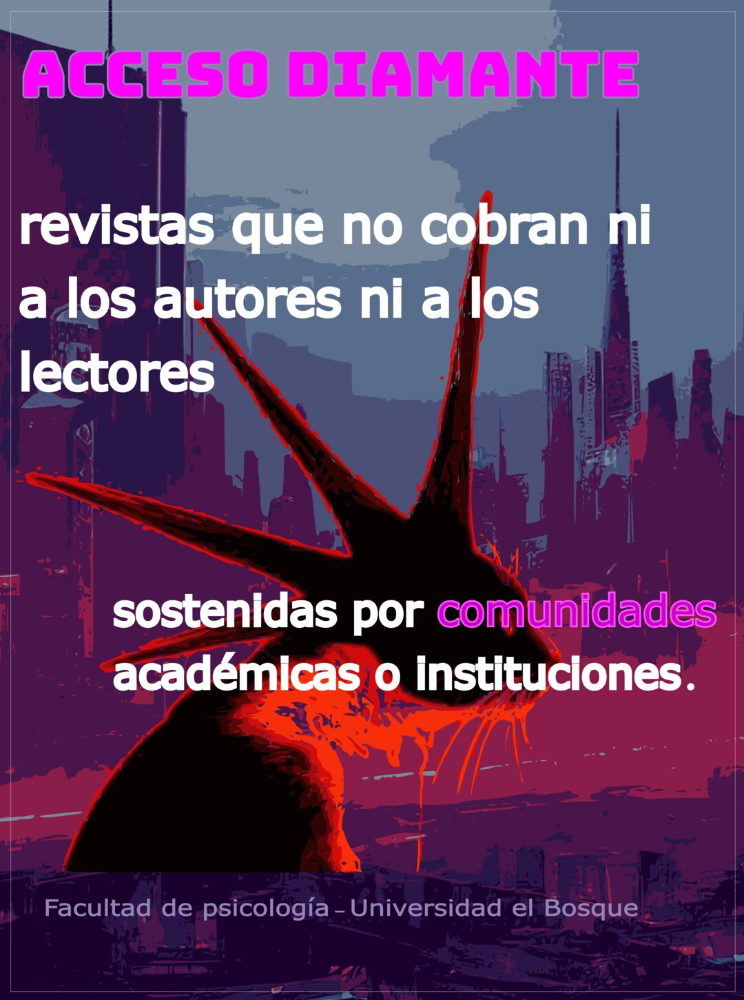

Esta es nuestra segunda serie de imágenes estáticas diseñada por [Marcela Puentes](../../../people/marcela-puentes.qmd). En ella explicamos qué es el acceso abierto, por qué el ciclo tradicional de publicación científica reproduce una lógica comercial, y cuáles son las tres rutas principales para hacer que un artículo sea de acceso abierto: dorada, verde y diamante.

::: {layout-ncol=3}
{group="serie" alt="¿Qué es Acceso Abierto? Facultad de Psicología, Universidad El Bosque."}

{group="serie" alt="Es el principio de que los artículos y publicaciones científicas deben estar disponibles en internet de forma gratuita y sin restricciones. Así, cualquiera puede leerlos."}

{group="serie" alt="¿Cuál es el ciclo de publicación? Investigadores producen artículos, que pasan por revisión de pares no remunerada; las editoriales venden esos artículos a precios altísimos a las mismas universidades que los produjeron. Este modelo reproduce una lógica comercial en la ciencia."}

{group="serie" alt="Para romper ese ciclo hay tres rutas principales: acceso dorado, acceso verde y acceso diamante."}

{group="serie" alt="Acceso dorado: el artículo se publica directamente en una revista de acceso abierto. El costo lo asume el autor o su institución a través de cargos de procesamiento de artículos, que pueden ser considerables."}

{group="serie" alt="Acceso verde: el autor deposita una versión del artículo (preprint o postprint) en un repositorio abierto, incluso si la versión oficial está detrás de un muro de pago."}

{group="serie" alt="Acceso diamante: revistas que no cobran ni a los autores ni a los lectores, sostenidas por comunidades académicas o instituciones."}
:::

## Publicación original

-  [Ver en Instagram](https://www.instagram.com/p/DeAP3-9Fv_w/)
-  [Ver en YouTube](http://youtube.com/post/Ugkxet1oRfi3tTd4lZKSdUaAJjAGdDqpsmgC)
