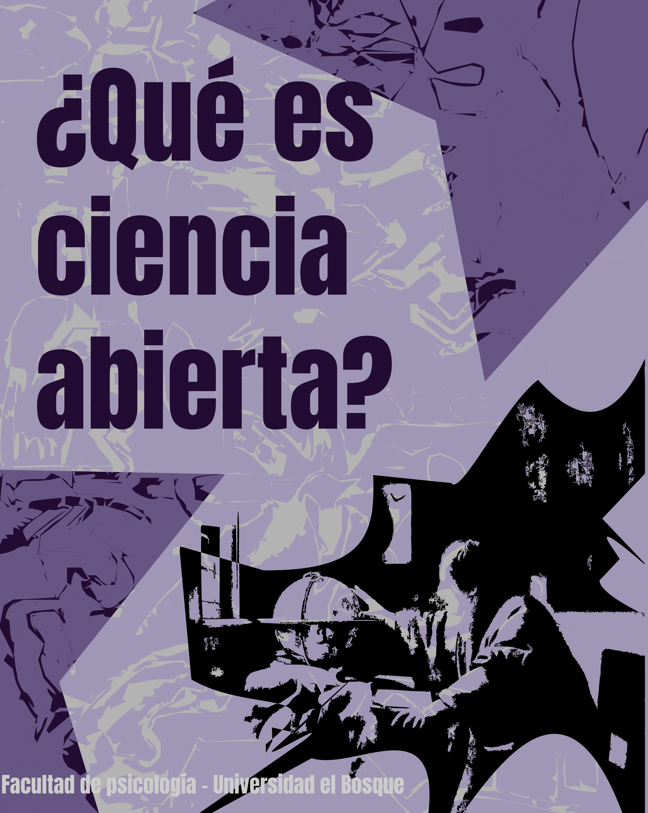
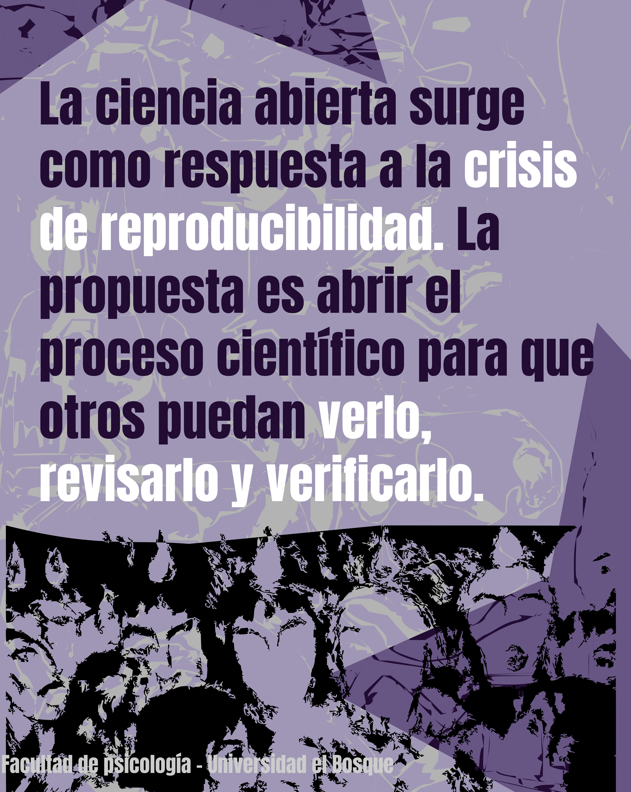
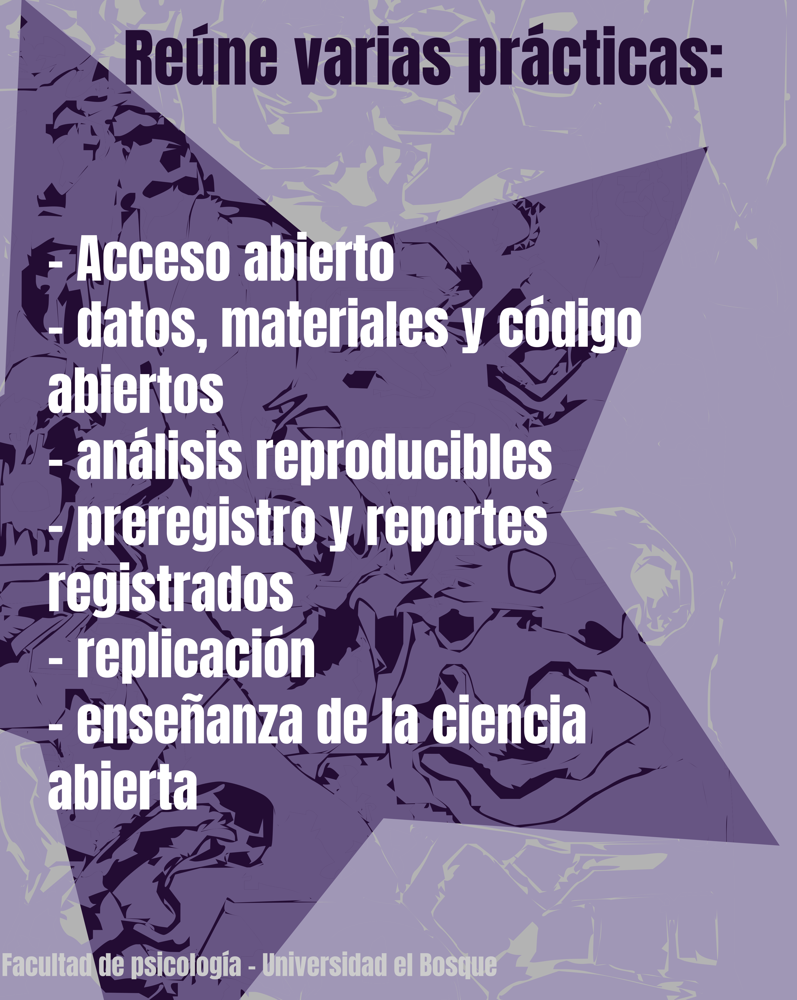
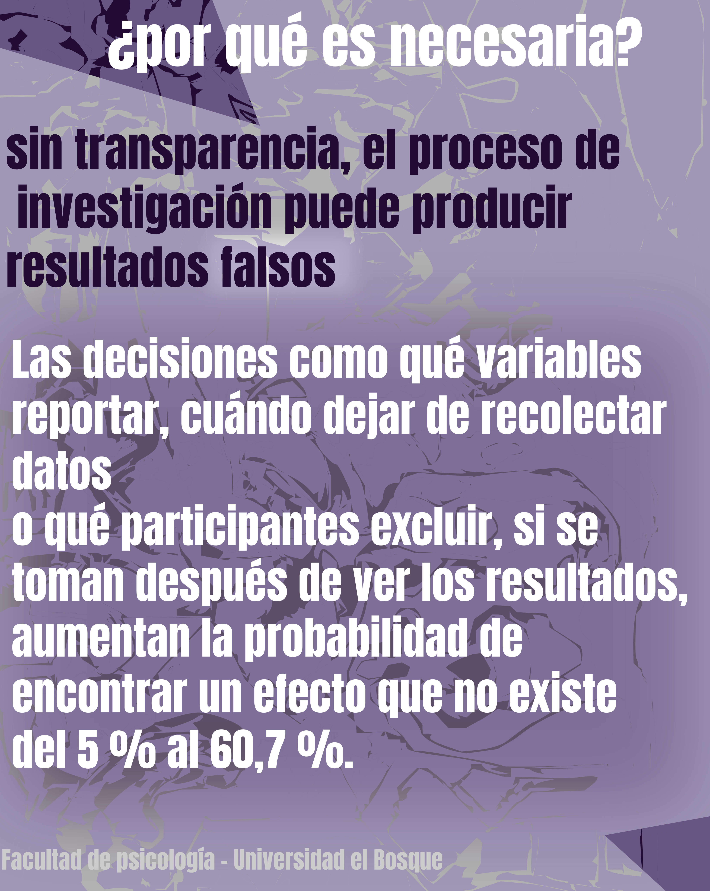
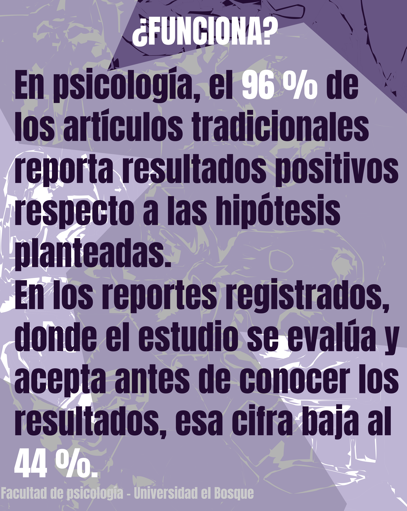
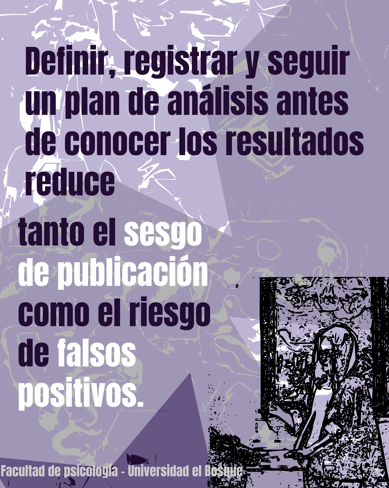
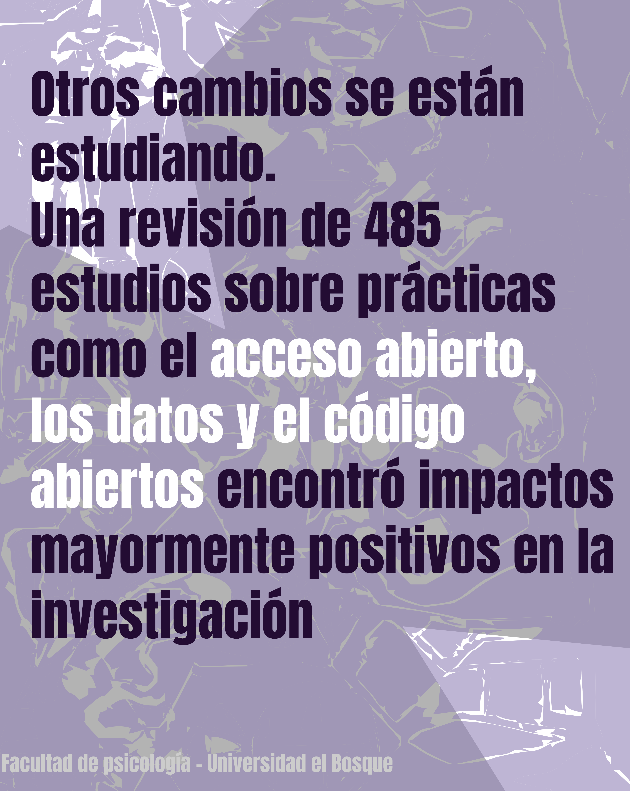
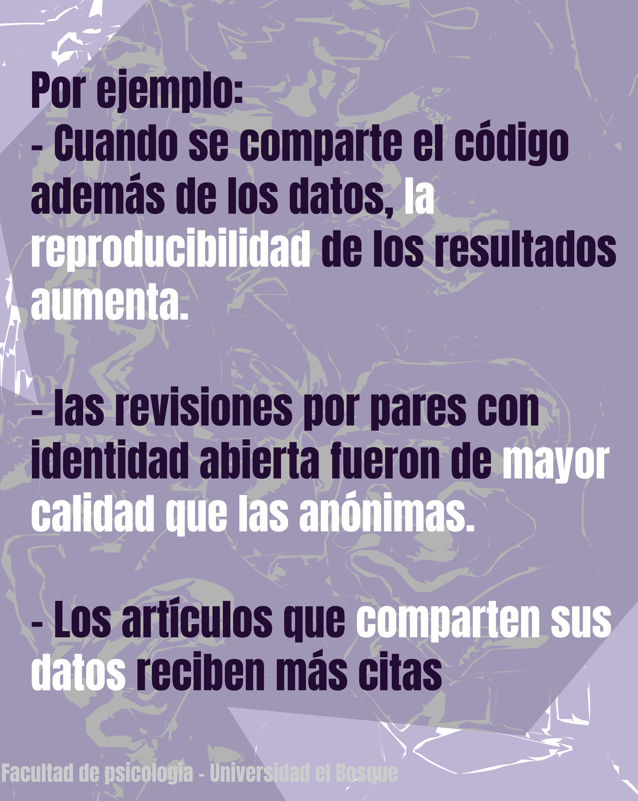
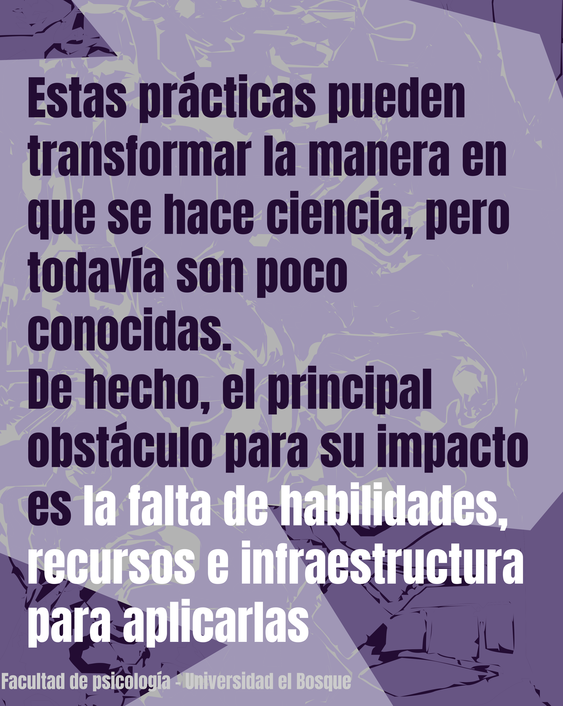
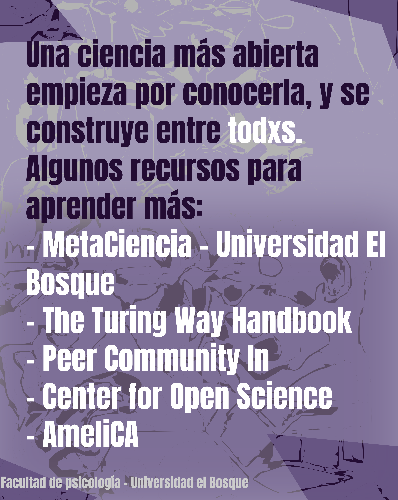

Esta es nuestra segunda serie de imágenes estáticas diseñada por [Marcela Puentes](../../../people/marcela-puentes.qmd).
En ella explicamos qué es la ciencia abierta, por qué surge como respuesta a la crisis de reproducibilidad y cómo la falta de transparencia en el proceso de investigación puede producir resultados falsos. También presentamos las prácticas que la componen (acceso abierto, datos y código abiertos, análisis reproducibles, preregistro y reportes registrados, replicación y enseñanza), la evidencia de que funcionan y algunos recursos para empezar a aplicarlas.

::: {layout-ncol=3}
{group="serie" alt="¿Qué es ciencia abierta? Facultad de Psicología, Universidad El Bosque."}

{group="serie" alt="La ciencia abierta surge como respuesta a la crisis de reproducibilidad. La propuesta es abrir el proceso científico para que otros puedan verlo, revisarlo y verificarlo."}

{group="serie" alt="Reúne varias prácticas: acceso abierto; datos, materiales y código abiertos; análisis reproducibles; preregistro y reportes registrados; replicación; y enseñanza de la ciencia abierta."}

{group="serie" alt="¿Por qué es necesaria? Sin transparencia, el proceso de investigación puede producir resultados falsos. Las decisiones como qué variables reportar, cuándo dejar de recolectar datos o qué participantes excluir, si se toman después de ver los resultados, aumentan la probabilidad de encontrar un efecto que no existe del 5 % al 60,7 %."}

{group="serie" alt="¿Funciona? En psicología, el 96 % de los artículos tradicionales reporta resultados positivos respecto a las hipótesis planteadas. En los reportes registrados, donde el estudio se evalúa y acepta antes de conocer los resultados, esa cifra baja al 44 %."}

{group="serie" alt="Definir, registrar y seguir un plan de análisis antes de conocer los resultados reduce tanto el sesgo de publicación como el riesgo de falsos positivos."}

{group="serie" alt="Otros cambios se están estudiando. Una revisión de 485 estudios sobre prácticas como el acceso abierto, los datos y el código abiertos encontró impactos mayormente positivos en la investigación."}

{group="serie" alt="Por ejemplo: cuando se comparte el código además de los datos, la reproducibilidad de los resultados aumenta; las revisiones por pares con identidad abierta fueron de mayor calidad que las anónimas; y los artículos que comparten sus datos reciben más citas."}

{group="serie" alt="Estas prácticas pueden transformar la manera en que se hace ciencia, pero todavía son poco conocidas. De hecho, el principal obstáculo para su impacto es la falta de habilidades, recursos e infraestructura para aplicarlas."}

{group="serie" alt="Una ciencia más abierta empieza por conocerla, y se construye entre todxs. Algunos recursos para aprender más: MetaCiencia, Universidad El Bosque; The Turing Way Handbook; Peer Community In; Center for Open Science; y AmeliCA."}
:::

## Publicación original

-  [Ver en Instagram](https://www.instagram.com/reel/DfHz7c9oRLx/?utm_source=ig_web_copy_link&obrf=NTc4MTIwNjQ2YQ==)
-  [Ver en YouTube](https://youtube.com/post/Ugkx3tQhjxAKw0pgukD_TNIc8A_tDGiEUKWE?si=ALLuWbmIFo0GTxKE)
