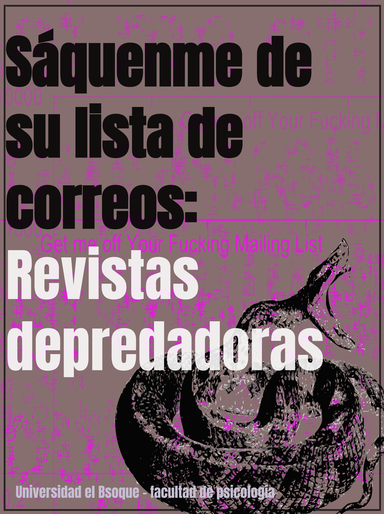

Esta es nuestra tercera serie de imágenes estáticas diseñada por [Marcela Puentes](../../../people/marcela-puentes.qmd). ¿Cuidado dónde publicas (y dónde lees)? Con algunos casos reales, mostramos cómo operan las revistas depredadoras: publicaciones que priorizan el beneficio económico por encima de la calidad científica, y que han llegado a aceptar artículos sin sentido, falsos o directamente absurdos con tal de cobrar por publicarlos.

::: {layout-ncol=3}
{group="serie" alt="Portada «Sáquenme de su lista de correos: Revistas depredadoras», con una serpiente enroscada."}

![Get me off your fucking mailing list [@MazieresKohler2005; @Stromberg2014]](imagen-2.png){group="serie" alt="En 2014 una revista aceptó un artículo que repetía «Get me off your fucking mailing list»."}

![Una cura falsa contra el cáncer [@Bohannon2013]](imagen-3.png){group="serie" alt="2013: artículo falso sobre una cura del cáncer aceptado por más de 150 revistas; gráfico de resultados."}

![Anna O. Szust [@Sorokowski2017; @Mayer2019]](imagen-4.png){group="serie" alt="2017: psicólogos inventaron a Anna O. Szust («fraude» en polaco) y cuatro revistas la nombraron editora."}

![El estudio sobre los midiclorianos [@Neuroskeptic2017]](imagen-5.png){group="serie" alt="Una revista publicó un estudio sobre midiclorianos. Meme de Anakin y Padmé en cuatro recuadros."}

![¿Qué son las revistas depredadoras? [@Grudniewicz2019; @Burdick2017]](imagen-6.png){group="serie" alt="Las revistas depredadoras priorizan el beneficio económico por encima de la calidad científica."}

![¿Cómo se caracterizan? [@Grudniewicz2019]](imagen-7.png){group="serie" alt="Rasgos: información engañosa, malas prácticas editoriales, falta de transparencia y correos masivos."}
:::

## Publicación original

-  [Ver en Instagram](https://www.instagram.com/p/Dej9--gFvnF/?img_index=1)
-  [Ver en YouTube](http://youtube.com/post/UgkxymF0I82_JUKdSYot4Tabu_LaIqXitn7c?si=OJNzOkU4uDvLzam8)
