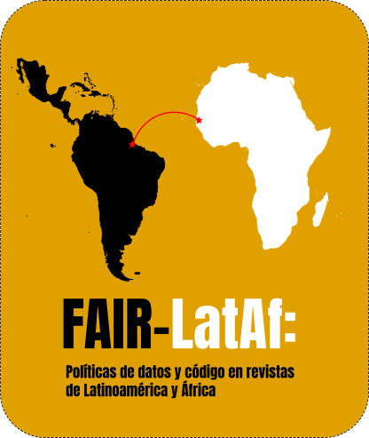

{.project-logo fig-alt="Logo de FAIR-LatAf"}

::: {.callout-note}
## Conceptos clave
Algunos conceptos usados en esta página: [Apertura de datos y código](../glosario/terminos/apertura-datos-codigo/index.qmd), [Principios FAIR](../glosario/terminos/principios-fair/index.qmd).
:::

## Descripción

Este proyecto estudia las **políticas de datos y código** declaradas en las guías para autores de revistas científicas de Latinoamérica y África indexadas en Scimago, y su alineación con los [**principios FAIR**](../glosario/terminos/principios-fair/index.qmd) para la [**Apertura de datos y código**](../glosario/terminos/apertura-datos-codigo/index.qmd). Los principios FAIR establecen que los datos (y, por extensión, el código) deben ser **fáciles de encontrar, accesibles, interoperables y reutilizables**, y las políticas editoriales son una de las vías principales para promover estas prácticas. A partir de un corpus de cerca de 1500 revistas, clasificamos la presencia y el nivel de exigencia de las políticas de datos y de código, evaluamos su alineación con elementos FAIR (como repositorios, identificadores persistentes y licencias) y comparamos los resultados entre regiones, países y áreas del conocimiento. La clasificación se realiza con apoyo de inteligencia artificial y se valida frente a codificación humana, con todos los materiales, datos y código disponibles de forma abierta.

## Equipo

| Nombre | Rol |
|---|---|
| [Juan David Leongómez](../people/juan-david-leongomez.qmd) | Investigador principal |
| [Marcela Puentes](../people/marcela-puentes.qmd) | Lider del proyecto |
| [Pilar Cardona](../people/pilar-cardona.qmd) | Investigadora |
| [Valentina Cepeda Monsalve](../people/valentina-cepeda.qmd) | Investigadora |
| [Andrés Lemus Morales](../people/andres-lemus.qmd) | Investigador |
| [Mariajose Ruiz Suescún](../people/mariajose-ruiz.qmd) | Investigadora |
| [Luna Valencia Guevara](../people/luna-valencia.qmd) | Investigadora |
| [Daniela Urrego Alvarado](../people/daniela-urrego.qmd) | Investigadora |
| [Samuel Felipe Castillo](../people/samuel-castillo.qmd) | Investigador |

## Objetivos

1. Construir un corpus de las guías para autores de las revistas de ambas regiones, con fecha de captura.
2. Clasificar la presencia y el nivel de exigencia de las políticas de datos y de código, por separado.
3. Evaluar el grado en que estas políticas incorporan elementos alineados con FAIR.
4. Validar la clasificación automatizada con IA frente a codificación humana.
5. Comparar los resultados entre regiones, países y áreas del conocimiento.

## Estado

::: {.callout-note}
**Estado:** En curso · Inicio: septiembre 2026 · Fin esperado: por definir
:::

## Materiales

- Protocolo preregistrado: *(pendiente)*
- Repositorio de código: *(próximamente)*

## Publicaciones relacionadas

- *(próximamente)*
