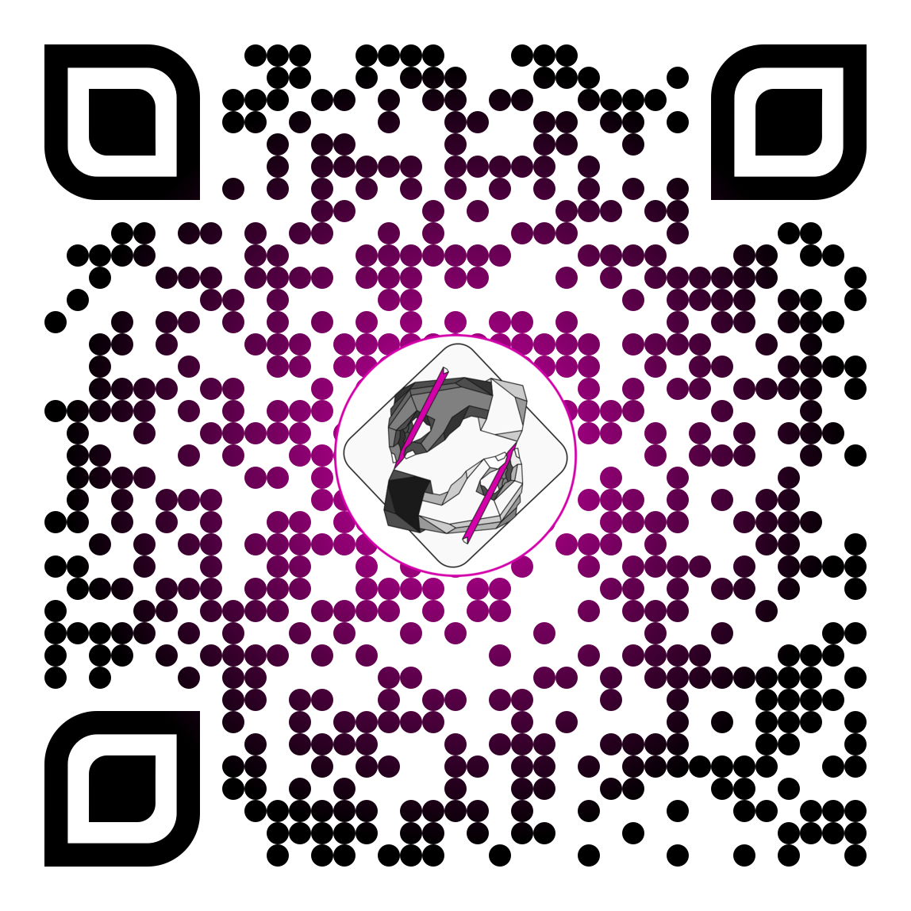
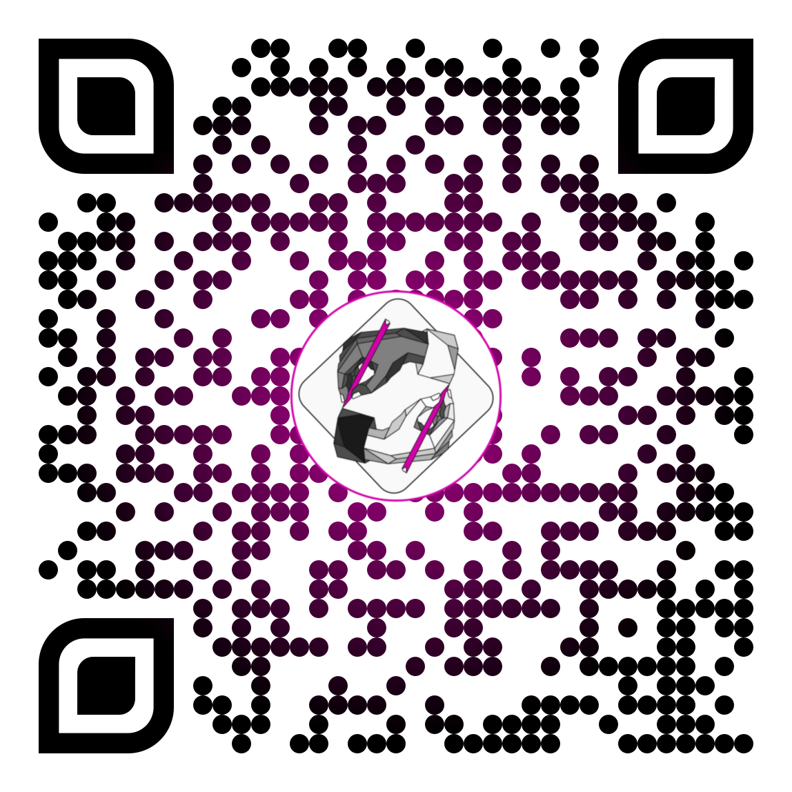
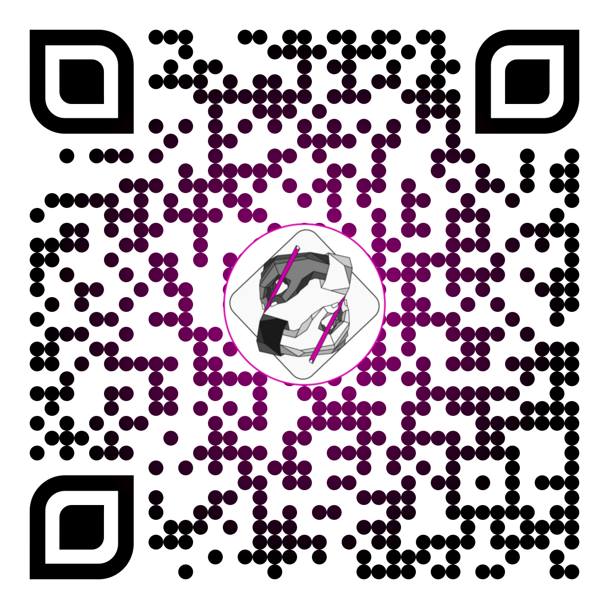
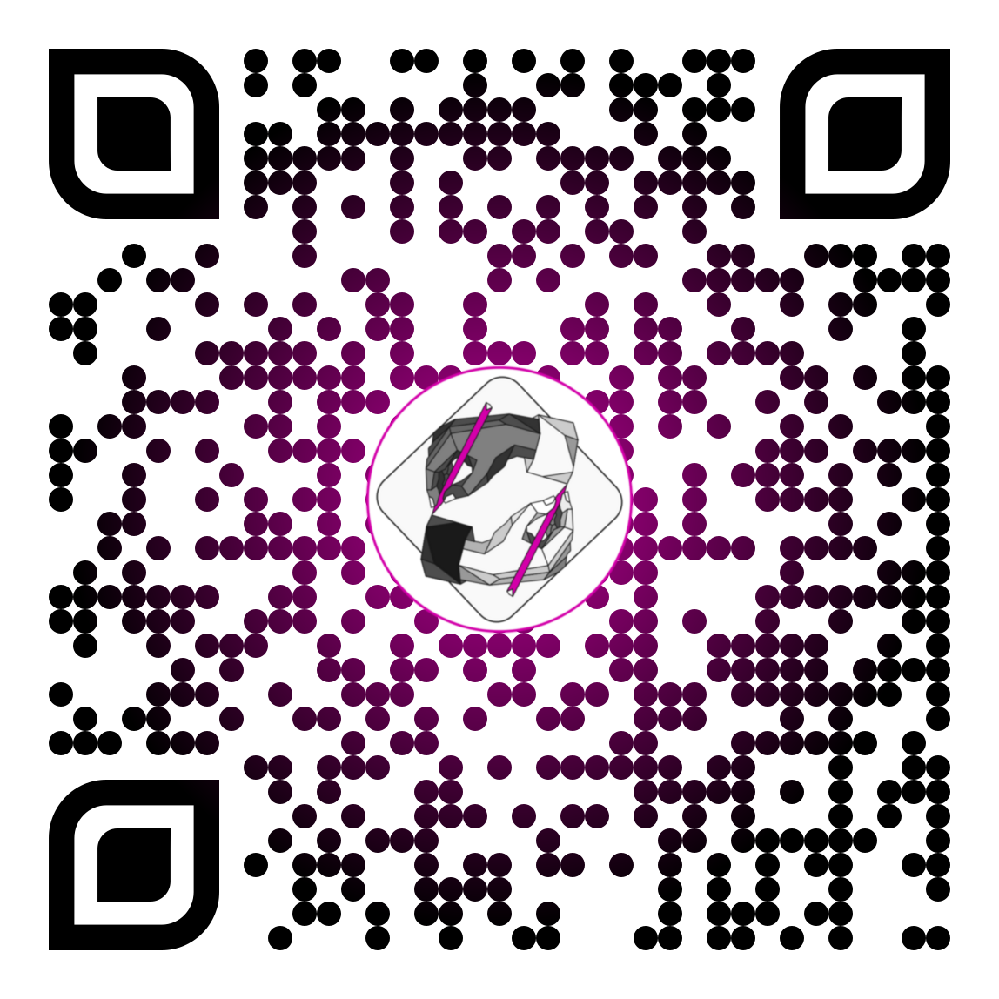

::: {.feria-stand}

::: {.hero-banner}
{.hero-logo alt="Logo MetaCiencia"}

# <strong>MetaCiencia</strong>

**Semillero abierto de ciencia, reproducibilidad y transparencia**

Facultad de Psicología · Universidad El Bosque · Bogotá, Colombia
:::

<!-- Listado oculto que solo existe para que las cifras de "integrantes"
     puedan contarse solas (mismo criterio de exclusión que people/index.qmd). -->
::: {.sr-only-listing}
::: {#sobre-integrantes}
:::
:::

<!-- Las cifras de integrantes, proyectos activos, piezas de divulgación y
     objetivos se cuentan solas a partir del contenido real de la página
     (ver data-count-from). Lo único que sigue siendo manual es "Productos
     de investigación", porque es texto narrativo sin un listado detrás. -->

0integrantes

0proyectos activos

0piezas de divulgación

0objetivos

Haz clic sobre cada título para ver el contenido.

::: {.feria-accordion}

::: {.callout-note collapse="true"}
##  Misión y visión

**Misión.** Formar una comunidad académica transdisciplinar comprometida con transformar la práctica científica desde la crítica informada, la apertura y la reproducibilidad. <strong>MetaCiencia</strong> busca cuestionar las estructuras tradicionales de producción de conocimiento, promover el uso de herramientas abiertas y fomentar una cultura científica ética, transparente y socialmente responsable, formando estudiantes que actúen como agentes de cambio en sus comunidades académicas.

**Visión.** Ser un referente nacional e internacional en la formación de nuevas generaciones de científicas y científicos que lideren una revolución metodológica en la ciencia, basada en la transparencia, la reproducibilidad, el acceso abierto y la justicia epistémica. <strong>MetaCiencia</strong> aspira a impactar no solo la academia, sino también las políticas científicas y la cultura investigativa en Colombia y América Latina.
:::

::: {.callout-note collapse="true"}
##  Objetivos

**Objetivo general.** Promover la formación crítica y práctica de estudiantes de diversas disciplinas en principios de [ciencia abierta](/glosario/terminos/ciencia-abierta/index.qmd), reproducibilidad computacional y ética científica, mediante el desarrollo de proyectos, productos y estrategias de divulgación que cuestionen y transformen las prácticas tradicionales de producción y comunicación del conocimiento, y que lideren procesos de cambio cultural en sus programas y facultades.

**Objetivos específicos:**

::: {#objetivos-especificos}
- Formar a estudiantes en herramientas y metodologías para la investigación reproducible, incluyendo el uso de [software libre](/glosario/terminos/software-libre/index.qmd), [preregistro](/glosario/terminos/prerregistro/index.qmd), [Reportes Registrados](/glosario/terminos/reportes-registrados/index.qmd) y análisis transparentes.
- Fomentar una cultura de ciencia abierta que trascienda el [acceso abierto](/glosario/terminos/acceso-abierto/index.qmd) tradicional, promoviendo el acceso abierto no comercial (vía verde), la apertura de datos y la documentación rigurosa de procesos científicos.
- Desarrollar productos de divulgación científica que comuniquen de forma accesible y crítica los principios de la metaciencia y la reproducibilidad, tanto dentro como fuera de la Universidad.
- Articular saberes y metodologías de distintas disciplinas para abordar problemas científicos desde una perspectiva transdisciplinar, ética y socialmente comprometida.
- Cuestionar y reflexionar sobre las estructuras de evaluación, publicación y validación científica, promoviendo prácticas más justas, inclusivas y rigurosas.
- Promover el liderazgo estudiantil como motor de cambio hacia una cultura científica más abierta, crítica y colaborativa en los distintos programas académicos de la Universidad.
:::
:::

::: {.callout-note collapse="true"}
##  Proyectos de investigación

::: {#sobre-proyectos-investigacion}
:::

Puedes ver el listado completo, incluyendo proyectos de divulgación, en la página de [Proyectos](/projects/index.qmd).
:::

::: {.callout-note collapse="true"}
##  Productos de investigación

El semillero fue registrado formalmente en marzo de 2026, por lo que aún no contamos con publicaciones formales. Los productos en desarrollo incluyen:

- El corpus y la clasificación de políticas editoriales de revistas construidos para el proyecto **FAIR-LatAf**.
- El mapeo de revistas y el análisis de barreras de adopción del proyecto **RRuta Latam**.
- Este mismo sitio web, como producto de divulgación científica abierta y reproducible.

Las publicaciones del semillero, a medida que estén disponibles, se irán agregando a la página de [Publicaciones](/publications/index.qmd).
:::

::: {.callout-note collapse="true"}
##  Divulgación

Difundimos los principios y prácticas de la ciencia abierta a través de nuestros canales de redes sociales: [YouTube](https://www.youtube.com/@metaciencia_ueb), [Instagram](https://www.instagram.com/metaciencia_ueb/) y [TikTok](https://www.tiktok.com/@metaciencia_ueb). Los videos para TikTok todavía están en producción.

::: {#sobre-divulgacion-piezas}
:::

Puedes ver todas nuestras piezas de divulgación en la página de [Divulgación](/divulgacion/index.qmd).
:::

::: {.callout-note collapse="true"}
##  Participación en eventos académicos y otras actividades relevantes

Iremos agregando aquí nuestra participación en congresos, charlas, talleres y otras actividades académicas a medida que se realicen. Mientras tanto, puedes seguir nuestras actividades y productos de divulgación en [YouTube](https://www.youtube.com/@metaciencia_ueb), [Instagram](https://www.instagram.com/metaciencia_ueb/) y [TikTok](https://www.tiktok.com/@metaciencia_ueb).
:::

:::

### Síguenos o visita el sitio desde tu celular

<a class="qr-item" href="https://mc-ueb.netlify.app" target="_blank" rel="noopener noreferrer">Sitio web</a>
<a class="qr-item" href="https://www.instagram.com/metaciencia_ueb/" target="_blank" rel="noopener noreferrer">Instagram</a>
<a class="qr-item" href="https://www.youtube.com/@metaciencia_ueb" target="_blank" rel="noopener noreferrer">YouTube</a>
<a class="qr-item" href="https://www.tiktok.com/@metaciencia_ueb" target="_blank" rel="noopener noreferrer">TikTok</a>

:::
